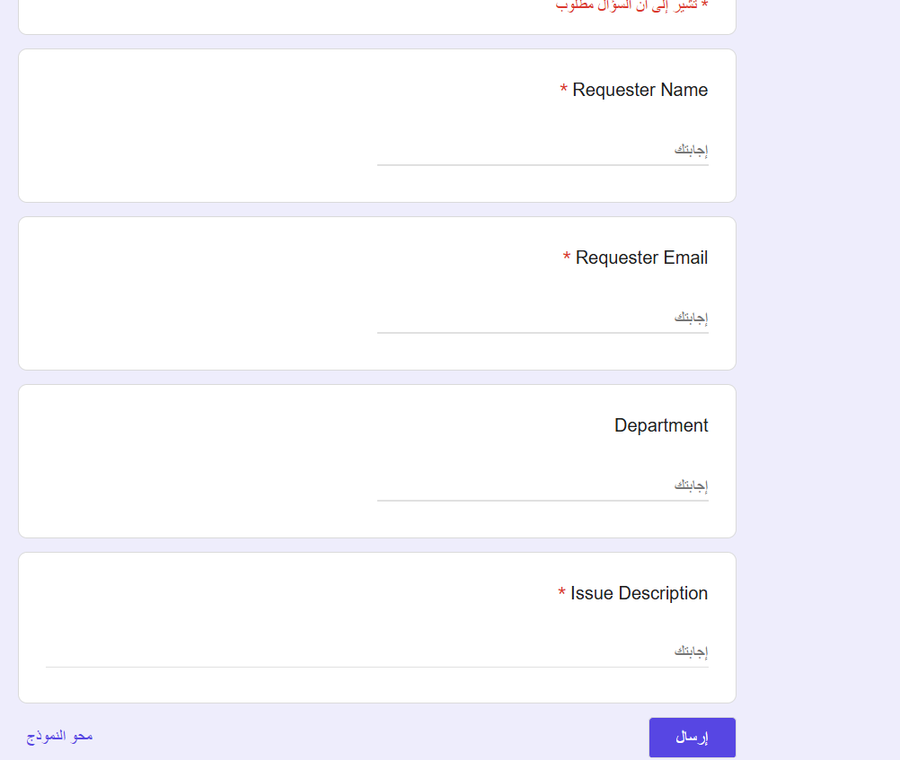
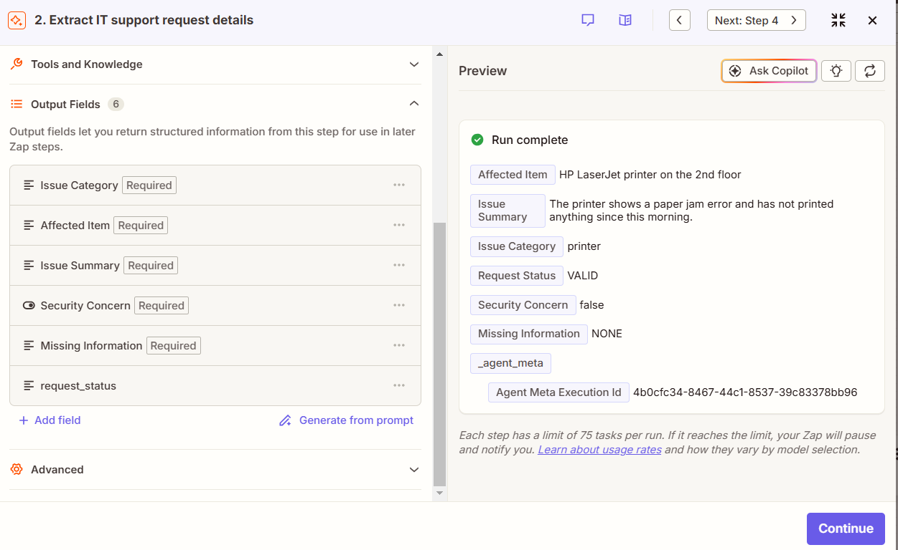
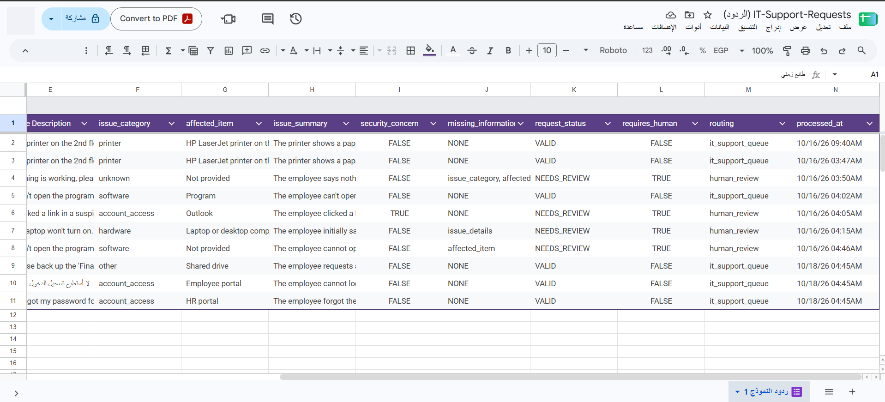
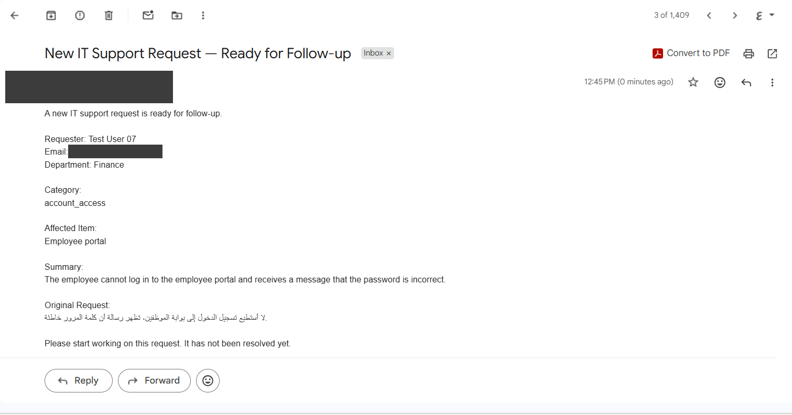
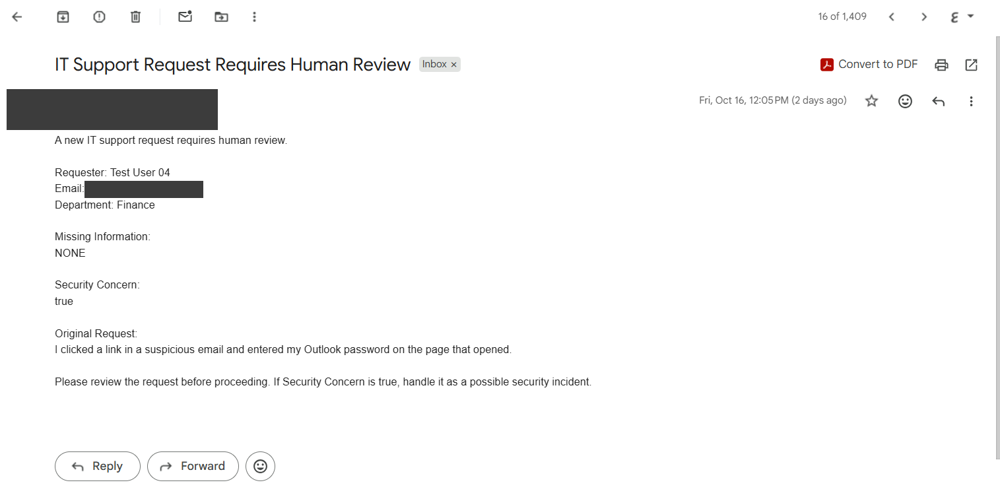
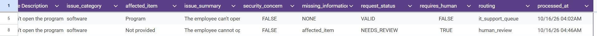

# AI IT Support Intake & Routing

> An AI-powered intake system that reads free-text IT support requests in **Arabic or English**, flags **security incidents**, and routes every request either to the IT support queue or to human review — automatically.

**🌐 English** · [العربية](#-النسخة-العربية)


---

## ✨ Highlights

| | |
|---|---|
| 🔐 **Catches security incidents** | *"I clicked a link and entered my password"* is flagged as a possible incident and sent to a human — never treated as a normal ticket. |
| 🌍 **Arabic and English** | Requests in either language are understood, classified, and summarized in English for the support team. |
| 🧭 **Nothing gets lost** | Clear requests go straight to support; vague, contradictory, or risky ones go to human review through a Fallback path. |
| 🧪 **Tested, broken, fixed** | 8 end-to-end test cases. One failed on the first run — I traced it to the AI prompt, fixed it, and re-tested. |
| 📐 **Designed before built** | Five design documents (analysis, workflow, data, decisions, automation) were written before opening Zapier. |

---

## 🎯 The Problem

Employees report IT issues in free text, and the quality varies a lot: some are clear, others are vague (*"Nothing is working"*), miss the affected device, contradict themselves, or hide a security incident.

Reading and sorting every request by hand is slow, and a risky request can easily be handled like a routine one.

**Goal:** clear requests reach support immediately; anything unclear or risky reaches a human.

---

## ⚙️ How It Works

```text
Google Form (employee request)
  ↓
Google Sheets — New Spreadsheet Row (trigger)
  ↓
AI by Zapier — extract fields + apply written rules → request_status
  ↓
Paths by Zapier
  ├─ VALID                    → Update the same row → Gmail: Ready for Follow-up
  └─ Fallback (anything else) → Update the same row → Gmail: Requires Human Review
```

| Tool | Role |
|---|---|
| Google Forms | Request form (name, email, department, issue description) |
| Google Sheets | One record per request, updated with the AI results |
| AI by Zapier | Understands the request and returns structured fields |
| Paths by Zapier | Routes by one signal: `request_status` |
| Gmail | Notifies the support team or the reviewer |



---

## 🧠 AI vs Rules vs Human

> **AI understands · Rules control · Humans judge**

| Layer | Responsibility |
|---|---|
| **AI** | Classifies the issue, extracts the affected item, writes a short English summary, flags security concerns, lists missing information, and returns `request_status` by applying rules written in the prompt. |
| **Rules (Zapier)** | Route on one exact value (`VALID`), with a **Fallback** so no request can fall between paths. Routing and `requires_human` are fixed values set by each path — not by the AI. |
| **Human** | Reviews anything vague, contradictory, or security-related. The AI only flags that an incident was *mentioned*; a person decides what really happened. |

**What the AI must not do:** invent details (brand, location, error message), diagnose or suggest fixes, or decide where the request goes.



<details>
<summary><b>Full AI prompt</b></summary>

```text
You extract structured information from an IT support request written by an employee.
The request may be written in Arabic or English.

Use ONLY information explicitly stated in the request.
Never invent, assume, or guess details (device brand, model, location, error message, or cause).
Do not diagnose the problem and do not suggest a solution.
Do not decide how the request should be routed.

Return exactly these fields:

issue_category
Exactly one of: hardware, software, network, account_access, email, printer, other, unknown
- hardware: physical devices (computer, laptop, monitor, keyboard, mouse, etc.), except printers
- software: applications or programs that do not work or need installation, except email
- network: internet, Wi-Fi, VPN, or network connection
- account_access: login, password, locked account, or permissions
- email: email services (Outlook, Gmail, etc.). Email password or login problems are account_access.
- printer: printers and scanners
- other: a clear technical request that fits none of the categories above
- unknown: the problem cannot be identified from the text

affected_item
The specific device, system, application, or service that is affected, as stated in the request,
as a short English phrase.
A generic word without a name (for example: the program, an app, the system, a website)
is NOT specific enough: return exactly: Not provided
A device type alone is enough (for example: laptop, printer, monitor).
If none is mentioned, return exactly: Not provided

issue_summary
One or two short English sentences summarizing only what the employee stated.

security_concern
Exactly true or false, in lowercase.
Return true only if the request explicitly mentions: clicking a suspicious link or attachment,
phishing, sharing a password or verification code, a hacked or compromised account,
unauthorized access, a virus, malware or ransomware, a lost or stolen device, or a data leak.
A forgotten password or a locked account alone is false.

missing_information
A comma-separated list using only these values: issue_category, affected_item, issue_details
- issue_category: the type of problem cannot be identified
- affected_item: no device, system, application, or service is mentioned
- issue_details: the description is too vague or contradictory to understand what happened
If issue_category is unknown, include issue_category.
If affected_item is Not provided, include affected_item.
If nothing is missing, return exactly: NONE

request_status
Exactly VALID or NEEDS_REVIEW, in uppercase.
Return VALID only if ALL of the following are true:
- issue_category is not unknown
- affected_item is not Not provided
- missing_information is exactly NONE
- security_concern is exactly false
Otherwise return NEEDS_REVIEW.
Decide request_status only from the fields above, after filling them.

Return only the values. No extra words, no quotes, no explanations.
```

</details>

---

## 🔑 Key Design Decisions

| Decision | Why |
|---|---|
| **Update the same row** by Row ID (trigger: *New Spreadsheet Row*) | One record per request. Creating rows or using *New or Updated Row* in the same sheet would re-trigger the Zap and cause a loop. |
| **Route on one signal** (`request_status`) with a **Fallback** path | Simple, testable routing. Anything that is not exactly `VALID` — including empty or unexpected values — goes to a human. |
| **Security concerns always go to a human**, even if the request is complete | A phishing click or a shared password is a possible incident, not a ticket. The reviewer email says so explicitly. |


---

## 🧪 Testing

All cases were submitted **from the form** after the Zap was published, and checked at four layers: AI output → path → sheet row → email.

| # | Scenario | Expected | Actual | Status |
|---|---|---|---|---|
| TC01 | Complete printer request | `VALID` | `VALID` → it_support_queue | ✅ |
| TC02 | *"Nothing is working, please help."* | `NEEDS_REVIEW` | `unknown` / `Not provided` → human_review | ✅ |
| TC03 | *"I can't open the program I need for my work."* | `NEEDS_REVIEW` | 1st run `VALID` ❌ → after prompt fix `NEEDS_REVIEW` | ✅ after fix |
| TC04 | Clicked a suspicious link, entered Outlook password | `NEEDS_REVIEW`, security = true | security `TRUE` → human_review | ✅ |
| TC05 | Login problem written **in Arabic** | `VALID` | `account_access` / `Employee portal` → it_support_queue | ✅ |
| TC06 | Back up the *Finance Reports* folder | `VALID`, category `other` | `other` / `Shared drive` → it_support_queue | ✅ |
| TC07 | Contradictory laptop / desktop description | `NEEDS_REVIEW` | `issue_details` missing → human_review | ✅ |
| TC08 | Forgot HR portal password | `VALID`, security = false | security `FALSE` → it_support_queue | ✅ |

**8 / 8 pass** (TC03 after one fix). 10 form submissions produced 10 rows — no duplicates.



### Arabic request → support queue (TC05)

`لا أستطيع تسجيل الدخول إلى بوابة الموظفين، تظهر رسالة أن كلمة المرور خاطئة.`



### Security incident → human review (TC04)

`I clicked a link in a suspicious email and entered my Outlook password on the page that opened.`



---

## 🛠️ What Broke and How I Fixed It

| Problem | Root cause | Fix |
|---|---|---|
| **TC03:** a vague request (*"the program"*) was marked `VALID` and sent to support | The prompt did not say that a generic word is not a specific item | Debugged layer by layer (form → trigger → AI → path → sheet), added an explicit rule to the prompt, re-published, and re-sent TC03 → `Not provided` / `NEEDS_REVIEW`. The failed row is kept as a record. |
| Path test failed with *missing sample* | The path rule used `request_status` from the **sheet** (empty) instead of the **AI step** | Re-selected the field from the AI step |
| Column names became `Column 6…14` | The header row was cleared together with test values | Re-typed the headers; only result cells are cleared since |
| *Test run* looked like a new request | It re-processes the old sample row | Verified real runs by **Row ID** in Zap History and tested from the form only |

**TC03 before and after the prompt fix** — row 5 (first run) vs row 8 (re-test):



**Lesson:** *"Successful"* in Zap History only means there was no technical error — not that the decision was right. Every result has to be checked against the expected outcome.

---

## 📐 Design Documents

Written before building, following **Understand → Design → Build → Test → Refine** (in Arabic):

| Document | Covers |
|---|---|
| [01 — Business Analysis](./docs/01-business-analysis.md) | Problem, scope, current process, success criteria |
| [02 — Workflow Decomposition](./docs/02-workflow-decomposition.md) | Tasks, order, Happy Path and Exception Path |
| [03 — Data Design](./docs/03-data-design.md) | Inputs, AI outputs, allowed values, sheet columns |
| [04 — Decision & Exception Design](./docs/04-decision-and-exception-design.md) | Rules, business exceptions vs technical failures |
| [05 — Automation Design](./docs/05-automation-design.md) | The full Zap, step by step |

---

## 🔮 Next Steps

- Add priority and an SLA for the support team.
- Alert automatically when a Zap step fails.
- Send the employee a confirmation, and ask for missing details automatically.
- Separate addresses for the support team and the security reviewer.

---

## 🔗 Links

**Try it:** [Submit an IT request](https://docs.google.com/forms/d/e/1FAIpQLScrWLmS9gPzpa5FDnOEfpsJDIOexQHzuT-MBO3-lp6g4rRfuw/viewform)

**Workflow:** private Zapier workspace — the full flow is shown at the top of this page.

---

## 👩‍💻 Author

**Dina Albaghdadi** — AI Automation

[LinkedIn](https://www.linkedin.com/in/dina-albaghdadi-79bb9a25a/) · [GitHub](https://github.com/Dina-Albaghdadi)

---
---

<div dir="rtl">

## 🌍 النسخة العربية

> نظام يستقبل طلبات الدعم الفني المكتوبة بنص حر **بالعربية أو الإنجليزية**، ويفهمها بالذكاء الاصطناعي، ويكتشف **الحوادث الأمنية**، ثم يوجّه كل طلب تلقائيًا إلى فريق الدعم أو إلى مراجعة بشرية.

> الصور موجودة في النسخة الإنجليزية أعلاه.

### ✨ أبرز النقاط

- 🔐 **يكتشف الحوادث الأمنية:** طلب مثل *"ضغطت على رابط وأدخلت كلمة المرور"* يُعلَّم كحادثة محتملة ويذهب لإنسان، ولا يُعامل كتذكرة عادية.
- 🌍 **عربي وإنجليزي:** يفهم الطلب بأي من اللغتين ويلخّصه بالإنجليزية لفريق الدعم.
- 🧭 **لا يضيع أي طلب:** الواضح يذهب للدعم مباشرة، والغامض أو المتناقض أو الخطر يذهب لمراجعة بشرية عبر مسار Fallback.
- 🧪 **اختُبر وفشل وأُصلح:** 8 حالات اختبار من البداية للنهاية، فشلت واحدة في أول تشغيل، فتتبعت السبب إلى تعليمات الـAI وأصلحته وأعدت الاختبار.
- 📐 **صُمّم قبل أن يُبنى:** خمس وثائق تصميم قبل فتح Zapier.

### 🎯 المشكلة

الموظفون يكتبون مشاكلهم التقنية بنص حر، وجودة الطلبات تختلف كثيرًا: بعضها واضح، وبعضها غامض (*"لا شيء يعمل"*)، أو لا يذكر الجهاز، أو متناقض، أو يخفي حادثة أمنية. فرزها يدويًا بطيء، وقد يُعامل طلب خطر كطلب عادي.

### ⚙️ طريقة العمل

نموذج Google ← شيت Google (المشغّل) ← AI by Zapier يستخرج الحقول ويطبّق القواعد ← Paths: `VALID` إلى فريق الدعم، وأي حالة أخرى إلى مراجعة بشرية ← تحديث نفس الصف وإرسال البريد المناسب.

### 🧠 الذكاء الاصطناعي والقواعد والإنسان

- **الـAI يفهم:** يصنّف المشكلة، ويحدد الجهاز أو النظام، ويلخّص بالإنجليزية، ويعلّم المخاوف الأمنية، ويحدد الناقص، ويُرجع `request_status`.
- **القواعد تتحكم:** التوجيه على قيمة واحدة (`VALID`) مع مسار Fallback، وقيم التوجيه ثابتة في كل مسار وليست من الـAI.
- **الإنسان يحكم:** يراجع كل طلب غامض أو أمني، والـAI يعلّم فقط أن حادثة *ذُكرت*، والإنسان يقرر.

### 🔑 قرارات التصميم

1. **تحديث نفس الصف** بدل إنشاء صف جديد، لتجنب تكرار السجلات ومنع تشغيل الـZap من جديد في حلقة.
2. **إشارة واحدة للتوجيه** مع مسار Fallback، فأي قيمة ليست `VALID` بالضبط تذهب لإنسان.
3. **الطلب الأمني يذهب دائمًا لإنسان** حتى لو كان مكتملًا.

### 🧪 الاختبارات

8 حالات أُرسلت من النموذج بعد نشر الـZap، وفُحصت كل حالة على أربع طبقات: مخرجات الـAI، والمسار، وصف الشيت، والبريد. **نجحت الثماني** (الحالة TC03 بعد إصلاح واحد)، و10 إرسالات أنتجت 10 صفوف بدون تكرار.

### 🛠️ ما الذي فشل وكيف أصلحته

- **TC03:** طلب غامض (*"البرنامج"*) خرج `VALID` وذهب للدعم. السبب أن التعليمات لم تذكر أن الكلمة العامة ليست جهازًا محددًا، فأضفت قاعدة صريحة وأعدت الاختبار فأصبح `NEEDS_REVIEW`.
- **اختبار المسار فشل** لأني اخترت `request_status` من الشيت الفارغ بدل خطوة الـAI، فأعدت اختياره.
- **أسماء الأعمدة تغيّرت** بعد مسح صف العناوين بالخطأ، فأعدت كتابتها.
- **Test run بدا كطلب جديد** لأنه يعيد معالجة صف العينة، فصرت أتحقق من التشغيل الحقيقي برقم الصف وأختبر من النموذج فقط.

**الدرس:** كلمة *"Successful"* في سجل Zapier تعني فقط عدم وجود خطأ تقني، ولا تعني أن القرار صحيح.

### 📐 وثائق التصميم

خمس وثائق في مجلد [docs](./docs): تحليل العمل، وتفكيك سير العمل، وتصميم البيانات، وتصميم القرارات والاستثناءات، وتصميم الأتمتة.

### 🔮 الخطوات القادمة

إضافة أولوية ومدة استجابة، وتنبيه تلقائي عند فشل خطوة، وإرسال تأكيد للموظف مع طلب المعلومات الناقصة تلقائيًا، وفصل عنوان فريق الدعم عن مراجِع الأمن.

</div>
